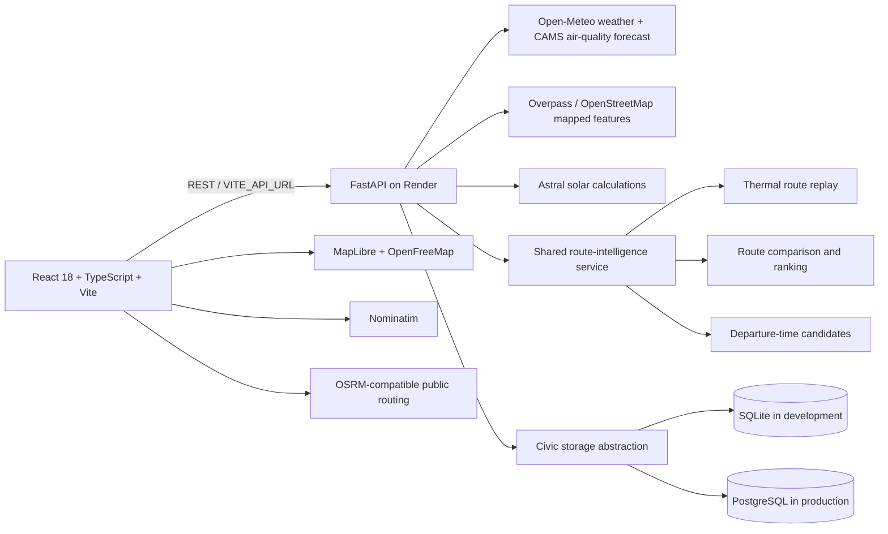

# ThermoRoute architecture

ThermoRoute is an existing React/TypeScript single-page application backed by a FastAPI service. Its environmental route scores are decision-support estimates built from returned road geometry, model forecasts, solar calculations, and mapped OpenStreetMap features; they are not live traffic measurements or medical predictions.

## System overview

## Frontend

- `src/App.tsx` owns top-level workspace navigation and settings.
- `src/components/modules/WorkspaceModules.tsx` implements overview, environment, mobility, civic reports, route insights, forecast replay, and city-planner views.
- `src/components/navigation/RoutePlanner.tsx` and `RealRouteMap.tsx` implement route planning, map display, GPS progress, and turn guidance.
- `src/services/` contains external-service clients and the shared backend URL configuration. `VITE_API_URL` is a public URL, never a secret; production builds should set it to the deployed API origin.
- Cloudflare Pages serves the Vite `dist` output. Pages' default SPA behavior routes non-asset paths to the root document when there is no top-level `404.html`.

## Backend and data flow

- `backend/main.py` defines the REST API, request validation, CORS, moderation checks, and health endpoint.
- `backend/services/route_intelligence.py` combines bounded route sampling, hourly forecast data, mapped shade evidence, and transparent route ranking.
- `backend/services/civic_store.py` uses parameterized SQL with a small DB-API abstraction: SQLite remains the local default, and PostgreSQL is selected by `DATABASE_URL`.
- PostgreSQL schema setup is additive and idempotent for the civic table; the existing SQLite file is not changed or automatically copied to another database.
- `APP_ENV=production` fails closed unless a PostgreSQL URL is configured. The health endpoint checks database connectivity, so Render can withhold a healthy status when the persistent database is unavailable.

## Security boundaries

- Public report creation and reads are intentionally anonymous; create requests are rate-limited per client IP and new reports are marked `unverified`.
- Status changes and deletion require a backend-only `CIVIC_ADMIN_TOKEN` using the bearer authorization header. The web form keeps the entered token in component memory only.
- CORS is configured with `CORS_ORIGINS`; local defaults are restricted to the Vite development origins. Production must list the exact Cloudflare Pages origin.
- Provider response bodies, internal exception messages, and raw error details are not returned by the API. Unexpected failures are logged server-side with generic client messages.
- Database credentials and moderation tokens belong in Render environment variables. Do not place secrets in Git or in any `VITE_` variable.

## Data provenance and known boundaries

- Weather and air quality are forecasts from model grids, not street sensors.
- Routing and travel times come from public road-network services and do not include live congestion.
- Shade, waterlogging risk, solar position, and exposure scores are estimates whose accuracy depends on available map data and model assumptions.
- Community reports are user submissions; spatial cells do not represent official neighbourhoods or measured heat.
- The Three.js concept scene is synthetic and labelled as demo content. The georeferenced City Planner is the MapLibre map.
- Public geocoding, routing, map, forecast, and Overpass services have external usage policies and no project SLA.
