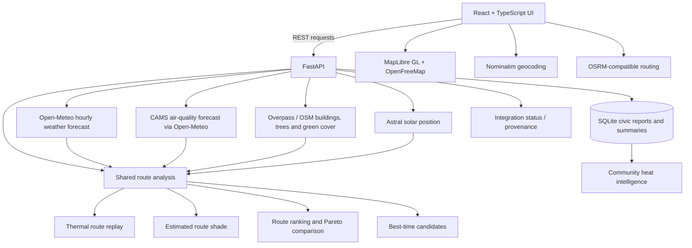

# ThermoRoute 3.2.1 — Heat-aware route intelligence for Bengaluru

ThermoRoute is a research and decision-support prototype that compares road-network routes and estimates environmental exposure along a journey. It combines public OpenStreetMap-derived road data, Open-Meteo/CAMS model forecasts, mapped building/tree features, a transparent rule-based scoring model, and citizen-submitted observations.

**It is not a medical device, emergency service, live-traffic navigation system, or a street-level sensor network.** Forecasts are model outputs; shade and waterlogging are estimates; user-submitted civic reports are unverified observations.

## What is implemented

| Workspace | Functionality | Data / limitation |
|---|---|---|
| Overview | Backend integration status, current model conditions for Bengaluru, quick links, 3D concept scene | Weather/AQI are Open-Meteo model data. Three.js city scene is synthetic and labelled Demo. |
| Navigation | Geocoding, drive/cycle/walk route requests, up to three alternatives where supported, turn instructions, MapLibre 3D buildings, GPS marker/progress, voice prompts, route share/save/export | OSRM-compatible public routing has no live congestion. GPS requires browser permission and localhost/HTTPS. |
| Environment | Search a place and inspect model current temperature, apparent temperature, UV, AQI, humidity, precipitation, wind and PM2.5 | Point/grid-cell model data, not a local sensor measurement. |
| Mobility | Compare driving, cycling and walking alternatives using actual returned route geometry; rank by balanced, fastest, shortest, coolest or cleanest-air objectives; inspect normalized scores and Pareto domination | Ranking covers only the returned routes. Missing environmental values remain unavailable and are not treated as zero exposure. No live traffic. |
| Civic | Submit and filter heat, no-shade, waterlogging, broken-signal, poor-air-quality, pedestrian-infrastructure, unsafe-crossing and other observations; update status; view category, approximate area-cell and trend summaries | SQLite persistence. Reports default to **Unverified** and represent community submissions, not measured heat intensity. |
| AI Insights | Replay sampled route conditions at predicted arrival times; inspect temperature, apparent temperature, UV, AQI, PM2.5, estimated shade and risk indicators; compare solar times, route alternatives and departure windows | Shared rule-based analysis. Forecasts are model outputs; shade and exposure are estimates, not medical risk scores. |
| Simulation | Inspect hourly weather and air-quality forecast points over the next hours | Single-coordinate model forecast, not a physical urban-climate simulation. |
| City Planner | Explore the OpenFreeMap/OSM map with 3D building extrusions and stored civic report markers | Building coverage/heights and civic report density depend on mapped data. Heat and shade raster layers are not implemented. |

## Architecture and data flow



### Main folders

```text
src/
  components/layout/       Header, sidebar and application layout
  components/navigation/   Route planner and MapLibre 3D route map
  components/modules/      Overview, Environment, Mobility, Civic,
                           AI Insights, Simulation and City Planner
  components/scene/        Synthetic Three.js concept city
  services/                Geocoding, routing, local conditions and analysis client
  types/                   API and navigation types
backend/
  main.py                  FastAPI application and REST endpoints
  services/                Route analysis, forecasts, solar/shade and SQLite services
  tests/                   Pytest unit and API tests
  data/                    Existing sample/fallback data and SQLite runtime file
.github/workflows/ci.yml   Frontend and backend CI
VERSION.json              Canonical application version
```

## Run on Windows

Requirements: Node.js 20+ recommended, npm, Python 3.10+ (Python 3.11 recommended).

### 1. Frontend

Open the project root (the folder containing `package.json`) in VS Code. Use `npm install` to synchronize the current `package.json` and lockfile. Do not run `npm ci` against an older lockfile supplied with a previous ZIP.

```powershell
npm install
npm run check:version
npm run type-check
npm run build
npm run dev
```

Open the Vite URL, normally `http://localhost:5173`.

### 2. Backend (a second terminal)

```powershell
py -m venv .venv
.\.venv\Scripts\Activate.ps1
py -m pip install -r backend/requirements.txt
py -m pip install -r backend/requirements-dev.txt
py -m pytest -q
py -m uvicorn backend.main:app --reload --host 127.0.0.1 --port 8000
```

Backend health: `http://127.0.0.1:8000/api/health`  
OpenAPI docs: `http://127.0.0.1:8000/docs`

If PowerShell blocks environment activation, run `Set-ExecutionPolicy -Scope Process -ExecutionPolicy Bypass` in that terminal, then activate again. Keep both terminal processes running while using the full application.

### Optional environment configuration

Copy `.env.example` to `.env` for backend-only optional settings. Copy `.env.frontend.example` to `.env.local` only if you need to override frontend service URLs. Keep API keys only in backend `.env`; never prefix secrets with `VITE_`.

`FORTYGUARD_API_KEY` is optional. FortyGuard is not required for Open-Meteo route-wide forecast sampling. If it is not configured, the existing legacy `/api/optimize` integration can use its explicit fallback path; the new route-wide analysis does not invent weather/AQI values when forecast requests fail.

## Data honesty and provenance

| Label | Meaning in ThermoRoute | Example |
|---|---|---|
| **Live** | An event or record fetched at request time, not necessarily a physical sensor measurement | A citizen report read from the local SQLite database; API health response |
| **Forecast** | A model-generated current or future condition | Open-Meteo temperature/apparent temperature, UV and CAMS-derived AQI |
| **Estimated** | A value produced by ThermoRoute's assumptions/calculations | Solar position, estimated building shadow, exposure index, CO₂ estimate, route duration |
| **Fallback** | A backup value explicitly used because the primary integration did not provide data | Legacy backend climate fallback sample |
| **Demo** | Synthetic or illustrative content | Procedural Three.js concept city and its decorative heat/flood/traffic elements |

No missing forecast field is replaced with a made-up temperature or AQI in route-wide AI Insights. Missing components are omitted from the score and the remaining weights are renormalized. The page shows source status and limitations for each analysis.

## Route-wide analysis model

### Thermal route replay, sampling and duration correction

The selected route and up to two other returned alternatives are sampled at approximately equal distance intervals (default target spacing 400 metres, configurable within request limits, maximum 20 samples per candidate). Total OSRM route time is allocated to the `n - 1` intervals proportional to their distance:

```text
interval_time_i = route_time * interval_distance_i / total_route_distance
```

The final interval receives any floating-point remainder so that interval durations sum exactly to the supplied route duration. Each sample is assigned its predicted arrival time using cumulative route time. Open-Meteo forecast points are selected for each sample and linearly interpolated only between valid adjacent forecast hours. Values outside the available forecast range, or absent from the source response, remain unavailable; the origin value is not reused as a route-wide proxy. Weather and air-quality requests batch sample coordinates and responses are cached in-process for a short TTL. The replay slider shows the active sample, route position and forecast provenance.

### Solar position and estimated shade

ThermoRoute uses Astral for solar azimuth, elevation, sunrise and sunset at the route sample's arrival time and coordinates. Building footprints are retrieved from Overpass and projected to a local metric coordinate system before estimated shadow geometry is evaluated. Building height is taken from OSM `height` tags or explicitly estimated from `building:levels × 3 m`. The 3 m floor-height conversion is an assumption, not a measured height. Approximate shadow length is:

```text
shadow_length = building_height / tan(sun_elevation)
```

A building shadow intersecting a sampled route location may indicate shade. The replay map overlays the estimated mapped-building shadow polygons associated with the active sample and colors route intervals by estimated shade status. Tree shade is used only when mapped height and canopy dimensions are available; a mapped tree is not assumed to provide full shade. Route shade is weighted by evaluated route-interval length, not by an unweighted count of points. Outputs include height/tree coverage and a confidence label. This remains a coarse estimate, not a ray-traced or street-level sensor model. Incomplete OSM coverage is not evidence that shade is absent; unknown coverage is returned as unavailable. Solar controls compare the same route at morning, midday, afternoon and evening times, and outputs are labelled **Estimated**.

### Exposure index

The prototype normalizes the available components:

- Heat: apparent temperature from 24°C to 40°C mapped linearly to 0–100 and clamped.
- UV: UV index divided by 11, mapped to 0–100 and clamped.
- Air quality: US AQI divided by 300, mapped to 0–100 and clamped.
- Shade penalty: 100 for no mapped shadow identified, 0 for likely mapped shade, unknown when there is insufficient mapped evidence.

For profile weights `w`, the sample score is the weighted mean of available components only. The remaining weights are renormalized when a component is missing. Profile weights are product design assumptions, not medically validated risk coefficients. The route score is the mean of available sample scores.

### Personal profiles

Available profiles: adult, elderly, child, asthma-sensitive, outdoor worker, cyclist and pedestrian. They alter the relative weights of heat, UV, AQI and shade. These labels are not a recommendation about an individual's medical fitness or a medical risk assessment.

### Shared route decision engine

Fastest, shortest, coolest, cleanest-air and balanced strategies compare the actual candidate routes supplied by the routing service. Balanced ranking combines normalized time and available environmental scores according to the preference slider; single-objective strategies focus on their named metric. Missing environmental metrics are excluded from available score components rather than treated as zero exposure. The response includes travel time, distance, turn count, available heat/AQI exposure, shade, normalized ranking and Pareto-dominance status. Recommendation explanations describe the chosen objective. This comparison is not an exhaustive search of all roads.

### Best time to travel

The service evaluates departure candidates at 30-minute intervals up to six hours by default (the search window is configurable). It uses route forecast values at each candidate's predicted segment arrival times and does not extrapolate beyond the hourly forecast horizon. Candidate route duration is compared against the fastest returned alternative; the default maximum permitted extra travel time is 10 minutes. A recommendation is returned only when the time constraint is met and the required exposure data is available. If no candidate qualifies, the UI shows that no valid recommendation was established rather than forcing one. Candidate evaluation holds OSRM durations fixed and does not model future congestion.

### Community heat intelligence

Civic reports are validated with Pydantic and persisted in SQLite using parameterized SQL. Existing database files are migrated to add status/anonymity fields. Create requests are limited to 10 per client IP per hour; new reports are **Unverified**. The report API supports category, status and date filters, status updates and deletion. The hotspot summary includes category counts, seven- and thirty-day trends, and approximate coordinate-cell groupings. Those cells are not official neighbourhood boundaries and report density is only the density of community submissions—not scientifically measured heat intensity.

### Rain/waterlogging estimate

Precipitation probability is categorized as lower (<30%), possible (30–59%) or elevated (>=60%). If a mapped tunnel or ford is found near a sample and precipitation probability is at least 30%, the sample is labelled `waterlogging_watch_estimate`. This is not a flood forecast and does not use a surveyed elevation model or a hydrological model.

### CO₂ estimate

For driving, the prototype multiplies distance by an assumed 170 g CO₂ per km. Cycling and walking are shown as zero direct tailpipe emissions. This does not account for vehicle type, fuel, occupancy, lifecycle emissions or actual fuel use.

## API endpoints

| Endpoint | Purpose |
|---|---|
| `GET /` | API identity and integration summary |
| `GET /api/health` | Backend health and last-known FortyGuard integration status; does not probe FortyGuard |
| `POST /api/fortyguard/environment` | Optional legacy FortyGuard environmental integration |
| `GET /api/fortyguard/status/{activity_id}` | Optional legacy FortyGuard activity status |
| `POST /api/optimize` | Existing route/thermal optimization workflow |
| `GET /api/civic/reports` | Read reports with optional category, status and date filters |
| `POST /api/civic/reports` | Create a local SQLite report (initial status: unverified) |
| `PATCH /api/civic/reports/{report_id}` | Update a report status |
| `DELETE /api/civic/reports/{report_id}` | Delete a report |
| `GET /api/civic/hotspots` | Category, approximate area-cell and reporting-trend summary |
| `POST /api/route-intelligence/analyze` | Shared route sampling, weather/AQI interpolation, solar/shade estimates, candidate ranking and departure comparison |
| `GET /api/routes` | Legacy sample/demo route endpoint; returns explicitly labelled sample routes |

## Automated checks

```powershell
npm run check:version
npm run type-check
npm run build
py -m pip install -r backend/requirements-dev.txt
py -m compileall -q backend
py -m pytest -q
```

GitHub Actions runs the frontend version/type/build steps and backend compilation/pytest checks on pushes and pull requests. Frontend dependency installation uses `npm install` so the lockfile can be reconciled if a dependency changes.

## Project documentation

- [Architecture and data flow](./docs/architecture.md)
- [Demo walkthrough](./docs/demo-script.md)
- [Viva questions and answer cues](./docs/viva-questions.md)

## Known limitations

1. Public routing, geocoding, map tiles, Open-Meteo and Overpass services can be rate-limited or unavailable. They are best-effort public services, not SLA-backed infrastructure.
2. Routing times are not live-traffic ETAs. There are no accident, construction, closure or live traffic-light feeds.
3. The public FOSSGIS OSRM service may return fewer than three alternatives and does not enumerate all possible routes.
4. OSM building heights, footprints, trees, crossings, tunnels and other tags are incomplete or inconsistent. Shade is an estimate based on sampled locations and available mapped geometry.
5. Forecasts are model grid-cell data. Spatial and hourly resolution may not represent microclimates or exact street conditions.
6. Departure-time comparison holds candidate route durations constant, applies the configured extra-time constraint, and does not model future traffic.
7. Rain/waterlogging flags are heuristic estimates, not flood warnings.
8. Civic reports are stored locally, are unverified until explicitly reviewed, and are not a public multi-user hosted service. Approximate coordinate cells are not neighbourhood boundaries. Do not enter personal or sensitive information.
9. The Three.js concept city remains synthetic; City Planner's MapLibre view is the georeferenced map with available building data.
10. Exposure scores and profile weights are experimental and are not medically validated. Do not use them for health or emergency decisions.
11. Natural-language LLM explanations are not connected. The UI presents computed facts and limitations directly; no API key or generated metrics are used.
12. Route comparison covers only alternatives returned by the public routing service and is not an exhaustive road-network optimization.

## Attribution and service policies

- OpenStreetMap contributors (ODbL): https://www.openstreetmap.org/copyright
- Nominatim usage policy: https://operations.osmfoundation.org/policies/nominatim/
- FOSSGIS routing service: https://routing.openstreetmap.de/about.html
- OpenFreeMap: https://openfreemap.org/
- Open-Meteo weather API: https://open-meteo.com/en/docs
- Open-Meteo air-quality API: https://open-meteo.com/en/docs/air-quality-api
- Overpass API: https://wiki.openstreetmap.org/wiki/Overpass_API
- MapLibre GL JS: https://maplibre.org/maplibre-gl-js/docs/

Check the current usage terms and attribution requirements of each public service before deployment or commercial use.

## Security

Never commit `.env`, `.env.local`, access tokens, API keys or passwords. Backend credentials belong only in backend environment variables. The frontend must never receive a secret through a `VITE_` variable.
