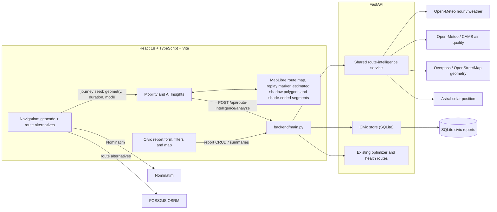

# ThermoRoute architecture

ThermoRoute is an existing React/TypeScript application with a FastAPI backend. The five environmental features share one route-analysis endpoint and the real alternatives returned by the existing routing workflow; they are not independent mock screens.

## System diagram

## Shared analysis flow

1. Navigation resolves origin and destination with Nominatim and obtains actual candidate routes from the existing OSRM routing client. Selecting **Explore Thermal Journey** transfers the geometry, duration, selected route, remaining alternatives, mode, and locations into AI Insights.
2. The browser sends the selected geometry and at most two other alternatives to `POST /api/route-intelligence/analyze`. The request also carries candidate travel time/distance/turn count, departure time, profile, ranking strategy, environmental preference, sample spacing, and departure constraints.
3. The backend samples each route at bounded distances and allocates its duration across route intervals. The interval durations sum exactly to the supplied route duration.
4. Batched Open-Meteo weather and air-quality forecasts are interpolated between adjacent valid hourly values at each sample's predicted arrival time. The service does not extrapolate or substitute origin values. Missing data remains unavailable and is excluded from exposure score components.
5. Astral supplies solar position and daylight times. Overpass building/tree/green-cover features support estimated shade calculations. Building footprints are evaluated in local metric coordinates; tagged height is preferred, while `building:levels × 3 m` is clearly an estimate. Route shade is weighted by evaluated interval length and returned with data coverage/confidence.
6. The same candidate analysis supports replay, route exposure and shade comparisons, normalized strategy ranking, Pareto-dominance labels, and 30-minute departure candidates. Best-time recommendations obey the configured extra-time and forecast-availability constraints.
7. Civic reports are handled separately by the same API application and persisted to SQLite. New reports remain unverified; filters and summaries describe user submissions, not measured environmental conditions.

## Data contracts

- Existing navigation and optimizer contracts remain available.
- The new analysis endpoint is `POST /api/route-intelligence/analyze`.
- Civic paths are `GET/POST /api/civic/reports`, `PATCH/DELETE /api/civic/reports/{report_id}`, and `GET /api/civic/hotspots`.
- Public data services are best effort. Forecast values, mapped feature coverage, and route alternatives can vary by request and location.

## Deliberate limitations

- OSRM candidate routes are not a complete enumeration of all possible paths and do not include live traffic.
- Forecasts are model grid-cell data, not street sensors.
- Shade estimates depend on incomplete OSM geometry and tags; estimated heights are not measurements.
- Departure evaluation holds route duration constant and does not model future traffic.
- Civic coordinate-cell groupings are approximate spatial summaries, not official Bengaluru neighbourhood boundaries.
- Exposure indices and personal profiles are explanatory decision-support values, not medical risk assessments.
